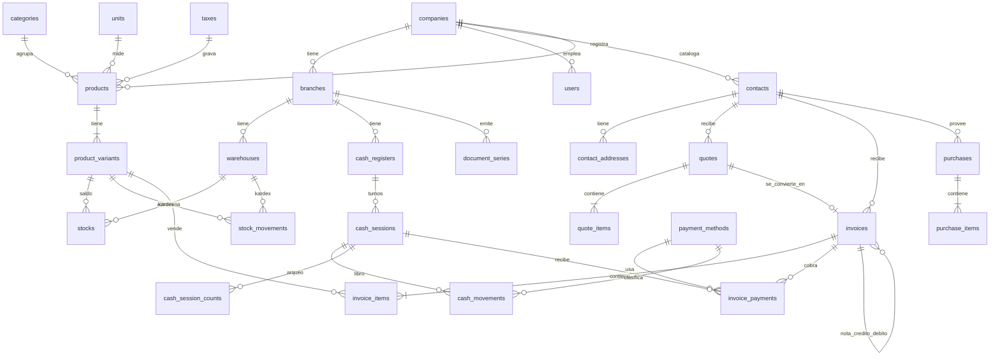

# Enterprise Invoicing, Inventory & POS Core Engine 💼⚡

Motor backend empresarial para la emisión de **Facturación Electrónica, Gestión de Inventario con Kardex Inmutable y Control de Cajas (POS)**. Diseñado con altos estándares de concurrencia, integridad referencial estricta y desacoplamiento por capas.

Inspirado en las arquitecturas abiertas de **[Crater Invoice](https://github.com/crater-invoice/crater)**, **[Invoice Ninja](https://github.com/invoiceninja/invoiceninja)** y **[Akaunting](https://github.com/akaunting/akaunting)**.

---

## 🏛️ Puntos Clave de Arquitectura & Base de Datos

1. **Multi-Sucursal & Multi-Almacén:**
   - Soporte nativo para empresas con múltiples sucursales físicas, puntos de venta independientes y almacenes descentralizados.
2. **Kardex Inmutable (Audit-Trail):**
   - Tabla `stock_movements` de solo inserción (*Append-Only*). Calcula saldos en tiempo real mediante el método de **Costo Promedio Ponderado**.
3. **Manejo de Concurrencia en Facturación:**
   - Control de correlativos (`document_series`) preparado para incrementos atómicos con `lockForUpdate()`, evitando duplicidad en emisión de comprobantes fiscales (Facturas `01`, Boletas `03`, Notas `07`/`08`).
4. **Protección Atómica de Turnos de Caja (POS):**
   - Restricción única inteligente `UNIQUE(cash_register_id, open_flag)` para impedir la apertura simultánea de dos turnos en la misma caja registradora tanto en PostgreSQL como en MySQL.

---

## 📊 Diagrama Entidad-Relación (ERD)

---

## 🗄️ Mapeo de Migraciones

| Migración | Módulo | Descripción |
| :--- | :--- | :--- |
| `000001_create_tenancy_tables` | Tenancy & Estructura | Empresas, sucursales y almacenes con auditoría y soft deletes. |
| `000002_create_contacts_tables` | Directorio Fiscal | Clientes y proveedores con identificación tributaria y direcciones. |
| `000003_create_catalog_tables` | Catálogo de Productos | Categorías, impuestos, unidades, productos y variantes SKU. |
| `000004_create_inventory_tables` | Inventario & Kardex | Stocks por almacén y movimientos inmutables con costo ponderado. |
| `000005_create_cash_tables` | Punto de Venta & Caja | Cajas, métodos de pago, sesiones/turnos y arqueo detallado. |
| `000006_create_sales_tables` | Ventas & Facturación | Series de documentos, cotizaciones, facturas, ítems y cobros. |
| `000007_create_purchases_tables` | Compras & Abastecimiento | Órdenes de compra a proveedores con impacto automático a inventario. |

---

## 🚀 Tecnologías & Estándares
- **PHP 8.2+** / **Laravel 11**
- **Strict Typing & Form Requests**
- **Clean Architecture & Service Layer**
- **PostgreSQL / MySQL Compatibility**
