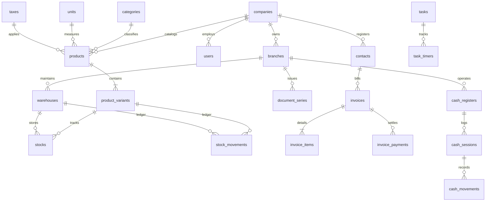

# Apex Billing — Enterprise Invoicing, Kardex & POS Engine

[](https://www.php.net/)
[](https://laravel.com/)
[](https://www.postgresql.org/)
[](https://www.docker.com/)
[](https://github.com/maurz-dev/enterprise-billing-system)
[](https://github.com/barryvdh/laravel-dompdf)
[](https://en.wikipedia.org/wiki/Clean_architecture)
[](https://opensource.org/licenses/MIT)

**Apex Billing** es una plataforma integral de backend y frontend de alto rendimiento diseñada para entornos comerciales de alta concurrencia. Unifica en un único ecosistema empresarial: **Facturación Electrónica Fiscal (Facturas, Boletas, Notas de Crédito), Generación de PDF A4 Oficial, Kardex Multialmacén Inmutable con Costo Promedio Ponderado (CPP/WAC), Control de Turnos de Caja POS con Auditoría de Descuadres, y un Módulo Companion de Seguimiento de Tiempo Facturable**.

Desarrollado bajo principios de arquitectura limpia con tipado estricto en PHP 8.2+, Laravel 11, PostgreSQL 15 y una interfaz reactiva SPA sin recargas (con hover prefetching y cambio de vistas en <50ms), soporte para Modo Oscuro/Claro y cambio dinámico de idioma (Español / Inglés).

---

## Módulos Principales de la Plataforma

```
                                  APEX BILLING ENGINE
        ┌───────────────────────────────────┬───────────────────────────────────┐
        │                                   │                                   │
  [1. Facturación]                  [2. Kardex & Stock]                  [3. Caja POS]
  • Correlativos atómicos           • Multialmacén centralizado          • Control de turnos
  • Bloqueo pessimistic lock        • Costo Promedio (CPP/WAC)           • Apertura con fondo
  • Estados: Draft/Emitido/Pagado   • Movimientos inmutables             • Arqueo físico de cierre
  • Generación de PDF fiscal        • Alertas de stock crítico           • Auditoría de descuadres
        │                                   │                                   │
        └───────────────────────────────────┴───────────────────────────────────┘
                                            │
                             [4. Companion: Tareas & Timer]
                             • Cronómetro en tiempo real
                             • Registro manual de horas trabajadas
                             • Conversión automática de horas a Factura
                             • Persistencia reactiva en localStorage
```

### 1. Facturación Electrónica & Comprobantes (`/invoices`)
* **Dashboard Financiero en Tiempo Real:** 4 tarjetas métricas con total facturado, saldos por cobrar, borradores pendientes e histórico general.
* **Filtros Inmediatos por Estado:** Pestañas dinámicas para ver comprobantes: *Todos, Vencidos, Borrador, Emitidos, Pagados y Anulados*.
* **Emisión con Bloqueo Pesimista (`lockForUpdate`):** Garantiza cero huecos correlativos y previene colisiones concurrentes en series fiscales multi-sucursal (`F001`, `B001`).
* **Generador de Facturas ([/invoices/create](http://localhost:8080/invoices/create)):** Selector de clientes con autocompletado de RUC/DNI y dirección, selector de series fiscales, cálculo de subtotal, IGV (18%) y total automático en soles (`S/`) o dólares (`$`).
* **Motor PDF A4 Fiscal ([/invoices/{id}/pdf](http://localhost:8080/invoices/1/pdf)):** Emisión e impresión de comprobantes con formato corporativo oficial, códigos QR, desglose de impuestos y términos bancarios.

### 2. Kardex Multialmacén & Valoración de Existencias (`/inventory`)
* **Métricas Globales de Existencias:** Monitoreo de unidades totales en almacenes, productos catalogados y semáforo de alertas para stock crítico.
* **Control Multialmacén:** Consulta detallada de inventario por almacén principal y sucursales.
* **Libro Mayor Inmutable (Kardex Valorizado):** Registro append-only de cada movimiento con fecha, producto, tipo (Entrada/Salida), motivo, cantidad, costo unitario y saldo resultante en tiempo real.
* **Algoritmo de Costo Promedio Ponderado (CPP/WAC):** Recálculo automático del costo unitario tras cada ingreso o compra para auditoría exacta del margen de ganancia.

### 3. Caja POS, Turnos y Conciliación (`/pos`)
* **Métricas de Terminal en Servicio:** Estado en vivo (*En Servicio* / *Cerrada*), efectivo estimado en gaveta, total de turnos auditados y terminales configurados.
* **Apertura y Cierre Formal de Turnos:**
  * Modal interactivo para registrar el fondo inicial en soles.
  * Cierre de sesión con conteo físico de dinero en caja y cálculo automático de variaciones: **Exacto**, **Sobrante (+)** o **Faltante (-)**.
* **Restricción Atómica en Base de Datos:** Índice único compuesto `UNIQUE(cash_register_id, open_flag)` que previene la apertura simultánea de turnos duplicados en el mismo terminal a nivel del motor relacional.

### 4. Tareas & Cronómetro Companion (`/tasks`)
* **Drawer Deslizante Lateral:** Accesible con un clic desde cualquier ventana mediante el botón del timer superior o la barra de navegación.
* **Cronómetro en Vivo:** Ticking en milisegundos con actualización del reloj global en la barra superior.
* **Persistencia Reactiva:** El estado del cronómetro activo se guarda en `localStorage` permitiendo navegar entre páginas sin perder el conteo ni generar peticiones de red innecesarias.
* **Puente a Facturación en 1 Clic:** Selecciona tareas completadas con tiempo acumulado y genera automáticamente un borrador de factura comercial listo para ser emitido.

---

## Decisiones de Arquitectura y Rendimiento

### A. Navegación SPA Ultrarrápida (<50ms)
Para eliminar la latencia de recargas de página en entornos contenedorizados:
1. **Pre-calentamiento en Memoria (`warmNavigationCache`):** Al cargar la aplicación, se precargan silenciosamente en segundo plano las rutas principales (`/invoices`, `/inventory`, `/pos`).
2. **Hover Prefetching:** Al pasar el cursor sobre cualquier enlace de la barra lateral, el contenido HTML se almacena en memoria antes del clic.
3. **Intercambio Atómico de DOM:** El enrutador del cliente sustituye únicamente el contenedor de contenido principal (`.apex-content`), manteniendo la sesión y el reloj activo sin parpadeos.

### B. Asignación Serializada de Correlativos (`lockForUpdate`)
Para evitar colisiones de numeración fiscal entre terminales concurrentes:
```php
$seriesRecord = DocumentSeries::where('branch_id', $branchId)
    ->where('doc_type', $docType)
    ->where('series', $series)
    ->lockForUpdate()
    ->first();
```

### C. Desacoplamiento de Existencias y Libro Mayor
La tabla `stocks` almacena el balance actual agregado por variante y almacén, mientras que `stock_movements` preserva la auditoría histórica inmutable:
$$\text{Costo Unitario}_{\text{nuevo}} = \frac{(\text{Stock}_{\text{anterior}} \times \text{Costo}_{\text{anterior}}) + (\text{Cantidad}_{\text{ingreso}} \times \text{Costo}_{\text{compra}})}{\text{Stock}_{\text{resultante}}}$$

---

## Modelo Entidad-Relación (Base de Datos)



---

## Catálogo de Endpoints y Rutas

### Rutas Web (Interfaz de Usuario SPA)

| Método | Ruta | Descripción | Módulo |
| :--- | :--- | :--- | :--- |
| `GET` | `/invoices` | Dashboard principal de comprobantes con métricas y tabs de estado | Facturación |
| `GET` | `/invoices/create` | Constructor interactivo de factura con cálculo de impuestos en vivo | Facturación |
| `POST` | `/invoices` | Guarda borrador o emite comprobante fiscal atómicamente | Facturación |
| `GET` | `/invoices/{id}` | Vista detallada del comprobante con opciones de cobro y anulación | Facturación |
| `GET` | `/invoices/{id}/pdf` | Generación e impresión directa del comprobante A4 en PDF | Motor PDF |
| `GET` | `/inventory` | Niveles multialmacén, alertas de stock mínimo y Kardex valorizado | Inventario |
| `GET` | `/pos` | Terminal de caja, arqueo de fondos y auditoría de turnos cerrados | Caja POS |
| `POST` | `/pos/open` | Abre formalmente un turno de caja con fondo inicial | Caja POS |
| `POST` | `/pos/{id}/close`| Cierra turno con conteo físico y registro de descuadres | Caja POS |
| `GET` | `/tasks` | Consulta de cronómetros activos y tareas recientes | Timer & Tareas |
| `POST` | `/tasks` | Registra nueva tarea con horas o inicia cronómetro en vivo | Timer & Tareas |
| `POST` | `/tasks/{id}/start-timer` | Inicia cronómetro en una tarea específica | Timer & Tareas |
| `POST` | `/tasks/{id}/stop-timer` | Detiene cronómetro y acumula los segundos transcurridos | Timer & Tareas |

### Endpoints REST API (v1)

| Método | Endpoint | Descripción | Formato / Autenticación |
| :--- | :--- | :--- | :--- |
| `GET` | `/api/v1/health` | Verificación de latencia y disponibilidad de servicios | JSON (`HealthController`) |
| `POST` | `/api/v1/invoices` | Creación de comprobante en borrador vía API | `StoreInvoiceRequest` ➔ JSON |
| `POST` | `/api/v1/invoices/{id}/issue` | Emisión fiscal atómica con asignación de correlativo | `lockForUpdate` ➔ JSON |
| `POST` | `/api/v1/invoices/{id}/void` | Anulación formal y restitución inmediata de existencias | Transacción Atómica |
| `GET` | `/api/v1/invoices/{id}/pdf` | Descarga de comprobante oficial en formato PDF | Binary Stream |
| `GET` | `/api/v1/kardex/{variantId}` | Consulta programática del libro mayor de movimientos | `StockMovementResource` |
| `POST` | `/api/v1/cash-sessions/open` | Apertura de turno en terminal de punto de venta | Compound Unique Check |
| `POST` | `/api/v1/cash-sessions/{id}/close` | Conciliación de arqueo físico y reporte de descuadre | `CashSessionResource` |

---

## Despliegue Local con Docker

### Requisitos Previos
* Docker Engine 24+ & Docker Compose v2+
* Git

### Pasos de Instalación

1. **Clonar el repositorio:**
   ```bash
   git clone https://github.com/maurz-dev/enterprise-billing-system.git
   cd enterprise-billing-system
   ```

2. **Configurar el archivo de entorno:**
   ```bash
   cp .env.example .env
   ```

3. **Compilar y levantar los contenedores:**
   ```bash
   docker compose up -d --build
   ```

4. **Ejecutar migraciones y datos de prueba:**
   ```bash
   docker compose exec app php artisan migrate:fresh --seed
   ```

5. **Optimizar cachés de producción:**
   ```bash
   docker compose exec app php artisan config:cache
   docker compose exec app php artisan route:cache
   docker compose exec app php artisan view:cache
   ```

6. **Acceder a la aplicación:**
   * **Dashboard Web:** [http://localhost:8080/invoices](http://localhost:8080/invoices)
   * **Kardex & Stock:** [http://localhost:8080/inventory](http://localhost:8080/inventory)
   * **Caja POS:** [http://localhost:8080/pos](http://localhost:8080/pos)
   * **Health Check API:** [http://localhost:8080/api/v1/health](http://localhost:8080/api/v1/health)

---

## Mapeo de Puertos y Servicios

| Contenedor | Servicio | Puerto Interno | Puerto Host | Propósito |
| :--- | :--- | :--- | :--- | :--- |
| `billing_webserver` | Nginx (Alpine) | `80` | `8080` | Gateway HTTP, Proxy Inverso y Entrega de Assets |
| `billing_app` | PHP-FPM (8.2) | `9000` | — | Procesamiento de Lógica de Negocio y Dominio |
| `billing_postgres` | PostgreSQL 15 | `5432` | `5433` | Base de Datos Relacional Principal con Restricciones ACID |
| `billing_redis` | Redis (Alpine) | `6379` | `6379` | Caché en Memoria y Manejo de Colas Asíncronas |

---

## Licencia

Distribuido bajo la [Licencia MIT](LICENSE). Desarrollado y mantenido de manera independiente para sistemas de gestión comercial y facturación electrónica.
