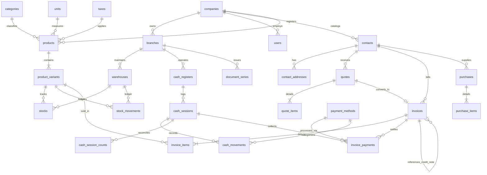

# Enterprise Invoicing, Inventory & POS Core Engine

[](https://www.php.net/)
[](https://laravel.com/)
[](https://www.postgresql.org/)
[](https://www.docker.com/)
[](https://github.com/barryvdh/laravel-dompdf)
[](https://en.wikipedia.org/wiki/Clean_architecture)
[](https://opensource.org/licenses/MIT)

Enterprise-grade backend engine designed for high-concurrency **Electronic Invoicing, Fiscal PDF Document Generation, Multi-Warehouse Inventory with Immutable Kardex, and Atomic Point-of-Sale (POS) Cash Register Management**.

Engineered using strict typing with PHP 8.2+, Laravel 11, and Domain Service Layer patterns, delivering an independent, unified architecture for electronic billing, billable task tracking, multi-warehouse Kardex, and POS terminal cash management.

---

## Technical Specifications & Architecture

### 1. Business Problem & Systems Engineering

Medium-sized businesses and multi-branch commercial networks face critical failure modes in high-volume transaction environments:

* **Fiscal Correlative Collisions:** Concurrent checkouts across POS terminals causing numbering gaps, duplicate series numbers, or regulatory rejections.
* **Cost Distortion & Negative Stock:** High-concurrency sales across distributed warehouses leading to inventory overselling and calculation inaccuracies in cost of goods sold (COGS).
* **Cash Register Audit Deficits:** Inability to maintain atomic shift transitions, cash variances, and transaction auditing across multiple cashiers.

### 2. Architectural Design Decisions

#### A. Pessimistic Row-Level Locking (`lockForUpdate`)

Sequential fiscal series allocation avoids race conditions using database-level row locking instead of volatile `MAX(number) + 1` queries:

```php
$seriesRecord = DocumentSeries::where('branch_id', $branchId)
    ->where('doc_type', $docType)
    ->where('series', $series)
    ->lockForUpdate()
    ->first();
```

Transactions queue at the relational engine level, guaranteeing zero skipped correlatives and strict serialized issuance.

#### B. Immutable Kardex with Weighted Average Cost (WAC)

Inventory management decouples current stock aggregates (`stocks`) from the append-only transaction ledger (`stock_movements`). Inbound shipments dynamically recalculate the weighted unit cost:

$$\text{Unit Cost}_{\text{new}} = \frac{(\text{Stock}_{\text{prev}} \times \text{Cost}_{\text{prev}}) + (\text{Qty}_{\text{in}} \times \text{Cost}_{\text{in}})}{\text{Total Stock}_{\text{result}}}$$

During invoice generation, an immutable unit cost snapshot is persisted within each document line item, guaranteeing exact historical profit margins even after subsequent cost fluctuations.

#### C. Atomic Shift Management for POS Terminals

Concurrent session conflicts on cash registers are mitigated at the database schema level using a compound unique index constraint:

```sql
UNIQUE(cash_register_id, open_flag)
```

During an active cashier shift, `open_flag = true`. Upon session reconciliation and closure, `open_flag` is updated to `NULL`. Relational engines allow multiple `NULL` instances in unique indices, preventing dual concurrent sessions while retaining historical closed session logs.

#### D. Layered Domain Architecture

Business logic is strictly decoupled from transport protocols:

* **Form Requests:** Handle schema validation, type casting, authorization, and sanitization before request arrival at the domain layer.
* **Domain Services:** Encapsulate database transactions (`DB::transaction`) with automatic rollbacks on domain violations (`BusinessException`).
* **API Resources:** Ensure serialized, deterministic JSON responses and prevent over-fetching.

---

## Project Structure

```text
├── app/
│   ├── Enums/                 # Backed Enums (DocType, InvoiceStatus, PaymentCondition)
│   ├── Exceptions/            # Centralized business error handling (BusinessException)
│   ├── Http/
│   │   ├── Controllers/       # REST API Controllers
│   │   ├── Requests/          # Request validation rules (Form Requests)
│   │   └── Resources/         # Response transformations (API Resources)
│   ├── Models/                # Eloquent models with typed casts and relationships
│   └── Services/              # Domain logic (InvoiceService, InventoryService, CashService, PdfService)
├── bootstrap/
│   └── app.php                # Application container & middleware pipeline
├── database/
│   ├── migrations/            # Relational schema migrations with foreign key constraints
│   └── seeders/               # Standard enterprise seeding (Company, Catalogs, Series)
├── docker/
│   └── nginx/conf.d/app.conf  # Nginx reverse proxy configuration
├── docs/
│   └── er-diagram.md          # Entity-Relationship specifications
├── resources/
│   └── views/pdf/invoice.blade.php # Printable corporate tax invoice Blade template
├── routes/
│   ├── api.php                # REST API routes versioned under /api/v1
│   ├── web.php                # Status & documentation health entry points
│   └── console.php            # CLI commands
├── composer.json              # Dependency manifests
├── docker-compose.yml         # Containerized services (PHP-FPM, Nginx, PostgreSQL, Redis)
└── Dockerfile                 # Alpine-based PHP 8.2 container build
```

---

## Entity-Relationship Model



---

## API Reference (v1)

### Core Endpoints

| Method | Endpoint | Description | Request Handler / Resource |
| :--- | :--- | :--- | :--- |
| `GET` | `/api/v1/health` | System health check and heartbeat | Status check closure |
| `POST` | `/api/v1/invoices` | Creates an invoice in draft status | `StoreInvoiceRequest` ➔ `InvoiceResource` |
| `POST` | `/api/v1/invoices/{id}/issue` | Atomically issues and numbers fiscal invoice | `IssueInvoiceRequest` ➔ `InvoiceResource` |
| `POST` | `/api/v1/invoices/{id}/void` | Voids document and returns stock to warehouse | `VoidInvoiceRequest` ➔ `InvoiceResource` |
| `GET` | `/api/v1/invoices/{id}/pdf` | Generates and streams printable fiscal PDF | Stream via `PdfService` |
| `GET` | `/api/v1/kardex/{variantId}` | Retrieves auditable inventory movement ledger | `StockMovementResource` |
| `POST` | `/api/v1/cash-sessions/open` | Opens a cashier shift on a terminal | `OpenCashSessionRequest` ➔ `CashSessionResource` |
| `POST` | `/api/v1/cash-sessions/{id}/close` | Closes terminal session and records physical cash count | `CloseCashSessionRequest` ➔ `CashSessionResource` |

### Web Application & Time Tracking Endpoints

| Method | Route | Description | Module |
| :--- | :--- | :--- | :--- |
| `GET` | `/invoices` | Interactive invoices dashboard with status tabs, metrics, and instant filters | Invoicing & Sales |
| `GET` | `/invoices/create` | Modern New Invoice builder with client card, auto tax, and item table | Invoicing & Sales |
| `POST` | `/invoices` | Saves draft or atomically issues fiscal invoice with `lockForUpdate` | Invoicing & Sales |
| `GET` | `/invoices/{id}/pdf` | Generates and streams printable tax invoice A4 PDF | Fiscal PDF Engine |
| `GET` | `/inventory` | Multi-warehouse stock levels, min stock alerts, and Kardex movements | Inventory & Kardex |
| `GET` | `/pos` | Cash register shift terminal, opening/closing counts, and cash variance audit | POS & Cash Shifts |
| `GET` | `/tasks` | Retrieves active stopwatch status and recent timer entries | Time & Task Tracking |
| `POST` | `/tasks` | Registers new tasks with hours or starts live stopwatch timer | Time & Task Tracking |
| `POST` | `/tasks/{id}/start-timer` | Starts live stopwatch timer on an existing task | Time & Task Tracking |
| `POST` | `/tasks/{id}/stop-timer` | Pauses/stops running stopwatch and increments accumulated seconds | Time & Task Tracking |
| `POST` | `/tasks/convert-to-invoice` | Converts tracked billable hours directly into a legal Invoice draft | Billing Bridge |

---

## Local Deployment with Docker

### Prerequisites
* Docker Engine 24+ & Docker Compose v2+
* Git

### Step-by-Step Installation

1. **Clone the repository:**
   ```bash
   git clone https://github.com/maurz-dev/enterprise-billing-system.git
   cd enterprise-billing-system
   ```

2. **Configure environment variables:**
   ```bash
   cp .env.example .env
   ```

3. **Build and launch containers:**
   ```bash
   docker compose up -d --build
   ```

4. **Initialize database schema and test seeds:**
   ```bash
   docker compose exec app php artisan migrate:fresh --seed
   ```

5. **Verify deployment:**
   Access the health endpoint at [http://localhost:8080/api/v1/health](http://localhost:8080/api/v1/health).

---

## Service Port Allocations

| Service | Internal Port | Host Port | Description |
| :--- | :--- | :--- | :--- |
| **Web Server (Nginx)** | `80` | `8080` | HTTP Gateway & API Router |
| **Application (PHP-FPM)** | `9000` | — | Core Business Logic Engine |
| **Database (PostgreSQL)** | `5432` | `5433` | Primary Relational Persistence |
| **Cache & Queues (Redis)** | `6379` | `6379` | In-Memory Key-Value Store |

---

## Author & Maintainers

Maintained by **Maurice Chavez ([@maurz-dev](https://github.com/maurz-dev))**.

Distributed under the [MIT License](LICENSE).
