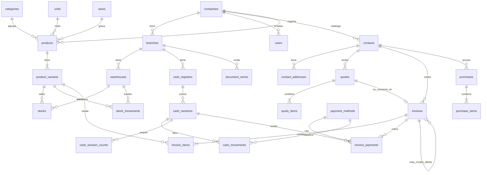

# Enterprise Invoicing, Inventory & POS Core Engine 💼⚡

[](https://www.php.net/)
[](https://laravel.com/)
[](https://www.postgresql.org/)
[](https://www.docker.com/)
[](https://en.wikipedia.org/wiki/Clean_architecture)
[](https://opensource.org/licenses/MIT)

Motor backend empresarial para la emisión de **Facturación Electrónica, Gestión de Inventario con Kardex Inmutable y Control de Cajas (Punto de Venta)**. Diseñado bajo estándares de alta concurrencia, tipado estricto con PHP 8.2+ y desacoplamiento por capas (Service Layer Pattern).

Inspirado en la arquitectura abierta y mejores prácticas de proyectos líderes como **[Crater Invoice](https://github.com/crater-invoice/crater)**, **[Invoice Ninja](https://github.com/invoiceninja/invoiceninja)** y **[Akaunting](https://github.com/akaunting/akaunting)**.

---

## 🏛️ Características de Arquitectura & Lógica de Negocio

1. **Capa de Servicios Desacoplada (Service Layer Pattern):**
   - Controladores delgados (*Skinny Controllers*) que delegan la lógica a servicios especializados:
     * `InvoiceService`: Orquestación de borradores, emisión con correlativo bloqueado, anulación y cobros.
     * `InventoryService`: Movimientos atómicos de kardex y recálculo de costo promedio ponderado.
     * `CashService`: Apertura/cierre de turnos de caja, conciliación de efectivo y arqueo físico.
2. **Kardex Inmutable con Costo Promedio Ponderado (Audit-Trail):**
   - Tabla `stock_movements` de solo inserción (*Append-Only*). Las entradas recalculan dinámicamente el costo unitario promedio; las salidas auditan el costo de venta y validan stock disponible con bloqueo pesimista (`lockForUpdate()`).
3. **Manejo de Concurrencia en Facturación:**
   - Control de correlativos (`document_series`) con `lockForUpdate()`, garantizando numeración secuencial y sin saltos fiscales ante múltiples peticiones simultáneas.
4. **Protección Atómica en Turnos de Caja (POS):**
   - Restricción `UNIQUE(cash_register_id, open_flag)`: `open_flag` es `true` mientras el turno está activo y pasa a `NULL` al cerrar, garantizando a nivel de motor de base de datos que jamás existan dos turnos abiertos simultáneos en una misma caja registradora.
5. **Tipado Estricto & Enums Nativos (PHP 8.2):**
   - Backed Enums para tipos de documentos (`DocType`), estados de facturación (`InvoiceStatus`), movimientos de inventario (`StockMovementReason`) y condiciones de pago.

---

## 📂 Estructura del Proyecto

```text
├── app/
│   ├── Enums/                 # PHP 8.2 Backed Enums (DocType, InvoiceStatus, etc.)
│   ├── Exceptions/            # BusinessException (manejo unificado de errores 422)
│   ├── Http/Controllers/      # Controladores REST delgados para la API
│   ├── Models/                # 23 Modelos Eloquent con relaciones, casts y scopes
│   └── Services/              # Capa de negocio (InvoiceService, InventoryService, CashService)
├── bootstrap/
│   └── app.php                # Configuración modular moderna de Laravel 11
├── database/
│   └── migrations/            # 7 migraciones completas con constraints relacionales
├── docker/
│   └── nginx/conf.d/app.conf  # Servidor web Nginx optimizado
├── docs/
│   └── er-diagram.md          # Diagrama ER completo
├── routes/
│   └── api.php                # Endpoints REST organizados por dominios
├── composer.json              # Dependencias de producción y desarrollo
├── docker-compose.yml         # Entorno completo (PHP-FPM, Nginx, PostgreSQL, Redis)
└── Dockerfile                 # Contenedor Alpine liviano con extensiones PHP
```

---

## 📊 Diagrama Entidad-Relación (ERD)



---

## 🚀 Despliegue Local con Docker

```bash
# 1. Clonar el repositorio
git clone https://github.com/maurz-dev/enterprise-billing-system.git
cd enterprise-billing-system

# 2. Configurar variables de entorno
cp .env.example .env

# 3. Levantar servicios con Docker Compose
docker compose up -d --build

# 4. Ejecutar migraciones
docker compose exec app php artisan migrate
```

---

## 👨‍💻 Autor
Desarrollado por **Maurice Chavez ([@maurz-dev](https://github.com/maurz-dev))**
