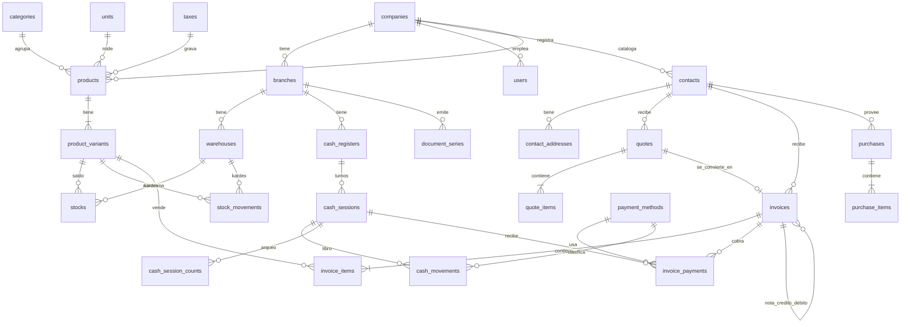

# Enterprise Invoicing, Inventory & POS Core Engine 💼⚡

[](https://www.php.net/)
[](https://laravel.com/)
[](https://www.postgresql.org/)
[](https://www.docker.com/)
[](https://github.com/barryvdh/laravel-dompdf)
[](https://en.wikipedia.org/wiki/Clean_architecture)
[](https://opensource.org/licenses/MIT)

Motor backend empresarial para la emisión de **Facturación Electrónica, Generación de Comprobantes PDF, Gestión de Inventario con Kardex Inmutable y Control de Cajas (Punto de Venta)**. Diseñado bajo estándares de alta concurrencia, tipado estricto con PHP 8.2+ y desacoplamiento por capas (Service Layer Pattern).

Inspirado en la arquitectura abierta y mejores prácticas de proyectos líderes como **[Crater Invoice](https://github.com/crater-invoice/crater)**, **[Invoice Ninja](https://github.com/invoiceninja/invoiceninja)** y **[Akaunting](https://github.com/akaunting/akaunting)**.

---

## 💼 Caso de Estudio Laboral (Work Case Study)

### 1. El Problema de Negocio
Las medianas empresas y cadenas comerciales que operan con múltiples sucursales y puntos de venta concurrentes se enfrentan frecuentemente a tres fallas críticas en sus sistemas tradicionales:
* **Duplicidad de Correlativos Fiscales:** Cuando dos cajeros emiten facturas en el mismo milisegundo, se generan saltos de numeración o rechazos ante la autoridad tributaria (SUNAT / SAT).
* **Descuadre de Costos y Stock Negativo:** Venta simultánea del mismo producto desde diferentes terminales que provoca inventario negativo y pérdida del costo real de venta.
* **Falta de Trazabilidad en Cajas Registradoras:** Dificultad para auditar qué cajero abrió turno, cuánto efectivo físico debía existir contra lo registrado en el arqueo y qué egresos se realizaron.

### 2. Decisiones Técnicas y Soluciones Implementadas

#### A. Concurrencia en Facturación (`DocumentSeries` con `lockForUpdate`)
En lugar de calcular el correlativo con un simple `MAX(number) + 1` (que falla ante peticiones concurrentes), se implementó un bloqueo pesimista a nivel de fila (*Pessimistic Locking*):
```php
$seriesRecord = DocumentSeries::where('branch_id', $branchId)
    ->where('doc_type', $docType)
    ->where('series', $series)
    ->lockForUpdate()
    ->first();
```
Esto asegura que las transacciones concurrentes se encolen a nivel de base de datos, garantizando una numeración correlativa ininterrumpida.

#### B. Kardex Inmutable con Costo Promedio Ponderado
El módulo de inventario desacopla la tabla de saldos rápidos (`stocks`) del libro histórico inmutable (`stock_movements`, *Append-Only*). Las entradas recalculan dinámicamente el costo unitario mediante la fórmula estándar contable:
$$\text{Nuevo Costo Ponderado} = \frac{(\text{Stock Anterior} \times \text{Costo Anterior}) + (\text{Cantidad Nueva} \times \text{Costo Nuevo})}{\text{Stock Total Resultante}}$$
Al momento de facturar, se almacena una instantánea (*snapshot*) de este costo unitario dentro del comprobante para calcular márgenes de utilidad exactos.

#### C. Control Atómico de Turnos de Caja (POS)
Para garantizar que una caja no tenga dos cajeros operando al mismo tiempo, se implementó una restricción única inteligente:
```sql
UNIQUE(cash_register_id, open_flag)
```
Mientras la caja está abierta, `open_flag = true`. Al cerrar el turno, `open_flag` pasa a ser `NULL`. Dado que las bases de datos relacionales permiten múltiples `NULL` en índices únicos, el sistema protege la apertura concurrente sin bloquear futuros turnos.

#### D. Arquitectura Limpia (Form Requests + Services + API Resources)
Se eliminó la lógica de negocio de los controladores:
* **`FormRequests`:** Sanitizan y validan tipos, formatos de serie y existencia en base de datos antes de tocar el dominio.
* **`Services`:** Transacciones encapsuladas (`DB::transaction`) con rollback automático ante excepciones de negocio (`BusinessException`).
* **`JsonResources`:** Control estricto de la carga útil (*payload*) JSON para evitar over-fetching y estandarizar respuestas.

---

## 📂 Estructura del Proyecto

```text
├── app/
│   ├── Enums/                 # Backed Enums nativos de PHP 8.2 (DocType, InvoiceStatus, etc.)
│   ├── Exceptions/            # BusinessException (manejo centralizado de respuestas HTTP 422)
│   ├── Http/
│   │   ├── Controllers/       # Controladores delgados para la API REST
│   │   ├── Requests/          # Validaciones de entrada independientes (Form Requests)
│   │   └── Resources/         # Formateo y serialización de salida JSON (API Resources)
│   ├── Models/                # 23 Modelos Eloquent con relaciones y casts tipados
│   └── Services/              # Capa de negocio (InvoiceService, InventoryService, CashService, PdfService)
├── bootstrap/
│   └── app.php                # Configuración modular moderna de Laravel 11
├── database/
│   ├── migrations/            # 7 migraciones completas con constraints relacionales
│   └── seeders/               # Seeders realistas (Company, Contacts, Catalog, Series, Kardex)
├── docker/
│   └── nginx/conf.d/app.conf  # Servidor web Nginx optimizado
├── docs/
│   └── er-diagram.md          # Diagrama ER completo
├── resources/
│   └── views/pdf/invoice.blade.php # Plantilla Blade para PDF fiscal imprimible
├── routes/
│   └── api.php                # Endpoints REST organizados por dominios
├── composer.json              # Dependencias de producción y desarrollo
├── docker-compose.yml         # Entorno completo (PHP-FPM, Nginx, PostgreSQL, Redis)
└── Dockerfile                 # Contenedor Alpine liviano con extensiones PHP
```

---

## 📊 Diagrama Entidad-Relación (ERD)



---

## 🌐 Endpoints Principales de la API (v1)

| Método | Endpoint | Descripción | Form Request / Resource |
| :--- | :--- | :--- | :--- |
| `POST` | `/api/v1/invoices` | Crea un comprobante en estado borrador | `StoreInvoiceRequest` ➔ `InvoiceResource` |
| `POST` | `/api/v1/invoices/{id}/issue` | Emite y numera atómicamente el comprobante | `IssueInvoiceRequest` ➔ `InvoiceResource` |
| `POST` | `/api/v1/invoices/{id}/void` | Anula el comprobante y devuelve stock | `VoidInvoiceRequest` ➔ `InvoiceResource` |
| `GET` | `/api/v1/invoices/{id}/pdf` | Genera y descarga el PDF fiscal | Stream directo con `PdfService` |
| `GET` | `/api/v1/kardex/{variantId}` | Historial auditable de movimientos | `StockMovementResource` |
| `POST` | `/api/v1/cash-sessions/open` | Abre turno de caja registradora | `OpenCashSessionRequest` ➔ `CashSessionResource` |
| `POST` | `/api/v1/cash-sessions/{id}/close`| Cierra turno y registra arqueo físico | `CloseCashSessionRequest` ➔ `CashSessionResource` |

---

## 🚀 Despliegue Local con Docker

```bash
# 1. Clonar el repositorio
git clone https://github.com/maurz-dev/enterprise-billing-system.git
cd enterprise-billing-system

# 2. Configurar variables de entorno
cp .env.example .env

# 3. Levantar servicios con Docker Compose
docker compose up -d --build

# 4. Ejecutar migraciones y sembrar datos de prueba
docker compose exec app php artisan migrate --seed
```

---

## 👨‍💻 Autor
Desarrollado por **Maurice Chavez ([@maurz-dev](https://github.com/maurz-dev))**
